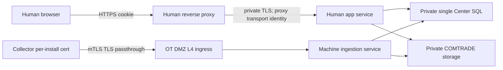

# D01 — Runtime host và trust boundary

Ngày rà soát:2026-11-09 (Asia/Bangkok). Package version0.1 PROPOSED. Baseline kết hợp PR6:d5ebc2acc18265786bae5af96ef3ba58c223e522; Phase4.2:9cd35889ddbbcc8d88e831419284877f4add5c6a. Source runtime/database: a0a6096; không sửa code trong 4.3A.
CURRENT là trạng thái source/DB; VERIFIED chỉ phạm vi quan sát/evidence được nêu; PROPOSED không thực thi. Approval date/evidence/người ký:NOT_PROVIDED. Independent reviewer:NOT_PROVIDED. Không tự đổi P0-IAM/readiness.
Nguồn đối chiếu và hash: [Baseline](Phase4_3A_Baseline_Inventory.md), [Evidence](Evidence_Index.md), Input_Manifest.json. Khuyến nghị cần được owner chọn, bind version/hash và phê duyệt; không phải configuration hoặc quyền đã có hiệu lực.

Decision ID:D01; E04; D07. Approval owner:Architecture + Security + OT + App owner. Current approval status:PENDING. Recommended/alternative options và tác động bên dưới.

## CURRENT và khoảng trống

Program.cs→CenterApplication.Build→CenterIdentityRuntime là host thật. Profile IAM chỉ Development/Testing/Lab, HTTPS loopback; không khởi động Store/BundleReceiver/InboxWorker. HumanSessionHandler đọc cookie opaque từ SQL, từ chối certificate hiện diện. Human Kestrel hiện AllowCertificate; /api/stations bị403. Các GET admin đã map nhưng D04 trả503; business data routes fenced. Khi flag tắt, legacy Demo/key/mTLS startup vẫn tồn tại. Không được triển khai hai đường vào cùng protected data rồi coi IAM đã bao phủ.

## Options và khuyến nghị D01

| Option | Security | Deploy/maintain | Compatibility/risk |
|---|---|---|---|
| A:hai listener cùng process | Có thể tách transport nhưng chung process/DI và route dispatch | Ít service hơn; phải enforce local endpoint trước routing | Sai bind/proxy có thể mở Human route trên Machine listener |
| B:Human/Machine host/service riêng | Tách identity/cert/trust/blast radius | Thêm service identity, secrets, monitoring và release phối hợp | Adapter v1 cần parity; giữ Core không đổi |
| C:mixed legacy host+API keys | Không có boundary Human độc lập đáng tin | Ít đổi code | Không khuyến nghị; key không thành human principal |

PROPOSED:B production; Lab hiện tại giữ profile loopback để kiểm chứng negative. Lab4.3B nên dựng hai process riêng với lab CA/DNS/origin đã chọn để gần topology đích; A chỉ là thử nghiệm có endpoint allowlist/test isolation, không production mặc định. Không bỏ guard Production chỉ để bật bằng config.

Human TLS có thể terminate ở approved proxy rồi re-encrypt private backend. Khuyến nghị mTLS proxy→backend nếu tổ chức hỗ trợ, nhưng đó là service transport identity, không là Collector hoặc human. Current HumanSessionHandler từ chối mọi client certificate nên chưa tương thích hop này; phải có trusted transport feature/validator và test, không simply bỏ cert check hoặc tin forwarded user. Machine ưu tiên TLS passthrough để ingestion trực tiếp kiểm leaf/chain/EKU/revocation/registry binding. Terminate Machine mTLS ở proxy là alternative cần signed identity assertion/secure hop/anti-replay, không copy header tùy ý.

Host/Origin allowlist, KnownProxies/KnownNetworks và hop count phải được owner/network bind; strip client-supplied forwarded/cert/actor headers, không header nào là authorization. Tài liệu ASP.NET Core nêu rõ cấu hình trust proxy; không mở trust-all để chữa lỗi HTTPS.[Microsoft proxy guidance](https://learn.microsoft.com/en-us/aspnet/core/host-and-deploy/proxy-load-balancer?view=aspnetcore-10.0) Absence explicit middleware không chứng minh deployment không bật forwarding tự động; rà soát cả hosting/environment flags trong 4.3B. Không đọc/in toàn bộ secret environment trong 4.3A.

Backend chỉ nhận hop service đã định danh; direct-port/bypass và Host spoof bị từ chối trước lookup. Listener/route allowlist độc lập: Human không có /api/stations; Machine không có /identity hoặc /api/identity/v1; cert không thay cookie, cookie không thay cert. SQL/storage private, không client access bằng object URL công khai. Network segmentation là thiết kế để OT owner review, không firewall change ở đây; căn cứ [NIST OT security guidance](https://csrc.nist.gov/pubs/sp/800/82/r3/final), không tự tuyên bố compliance.

## Canonical API release đề nghị, CHƯA xác nhận

Chọn prefix /api/identity/v1; ưu tiên /login như A02 proposal. /auth/login trong hồ sơ cũ cần disposition; không tạo alias. 21 nhóm API không phải21 URL duy nhất. Freeze OpenAPI, DTO/status/ETag/CSRF trước activation. DTO status ưu tiên PascalCase hiện UI runtime hiểu Pending/Approved/Applied, không đổi APPROVED→EFFECTIVE âm thầm. Revision/rowversion không được thay bằng client checkbox.

| ID | Method/path dưới prefix | Owner | CURRENT | PROPOSED release behavior |
|---|---|---|---|---|
| A01 | GET /context | Human auth | Chưa map | Public policy+CSRF, không user directory |
| A02 | POST /login | Human auth | /login và /auth/login đều chưa map | Chọn /login duy nhất; generic failures/challenge |
| A03 | GET /challenge | Human MFA | Chưa map | Restricted proof context |
| A04 | POST /challenge/verify | Human MFA | Chưa map | One-use assertion proof, no fake OTP |
| A05 | POST /challenge/restart | Human MFA | Chưa map | Bounded retries, không kéo dài vô hạn |
| A06 | POST /step-up | Human MFA | Chưa map | Bind action/resource/revision; không tự execute |
| A07 | POST /recovery-requests | Human recovery | Chưa map | Generic202, anti-enumeration |
| A08 | POST /password-reset | Human recovery | Chưa map | Consume/reset/revoke/audit atomic |
| A09 | GET /session | Human session | Chưa map | No automatic idle extension |
| A10 | POST /session/continue | Human session | Chưa map | Explicit CSRF/current authority; absolute unchanged |
| A11 | POST /logout | Human session | Chưa map | Revoke trước clear; idempotency semantics cần ký |
| A12 | GET /me, /me/sessions, /me/security-events | Human self | Chưa map | Self-only display refs, không bearer IDs |
| A13 | POST /me/password-change, /me/sessions/revoke | Human self | Chưa map | Reauth/CSRF/revoke theo policy |
| A14 | POST /me/mfa-change-requests | Human custody | Chưa map | Request riêng, không trực tiếp gỡfactor |
| A15 | GET /admin/users, /admin/users/{id} | Human admin | GET mapped; pending authority | Server target scope+ETag, không directory public |
| A16 | POST /admin/user-change-requests | Human admin | Chưa map | Controlled create/disable/reset/assignment intent |
| A17 | GET /admin/roles, /admin/permission-catalog; POST /admin/role-change-requests | Human admin | GET mapped; POST chưa map | Scoped dynamic roles+immutable request |
| A18 | GET /admin/station-options, /admin/station-grants; POST /admin/station-grant-requests | Human admin | Grants GET mapped; options/POST chưa map | Bound UserRole/target functions/expiry |
| A19 | GET /admin/change-requests/{id}; POST /admin/change-requests/{id}/decisions | Human workflow | Detail GET mapped; decisions chưa map | Independent review/approve; Apply internal sau đủ approvals |
| A20 | GET /admin/security-audit, /admin/security-audit/{id} | Human audit | GET mapped; pending authority | Redacted delegated scope |
| A21 | POST /admin/audit-export-requests; GET /admin/audit-export-requests/{id}, /admin/audit-export-requests/{id}/download | Human audit | Chưa map | Separate export permission, stream recheck |

Không public force-apply. First release đề nghị apply nội bộ ngay trong authenticated approval flow khi đủ điều kiện, commit recheck và MFA còn fresh. Nếu delay/worker apply, cần contract service executor riêng và durable bounded approvals; không giả human session hoặc dùng Collector credential để áp quyền. Wire endpoints chưa implement không được đổi thành CURRENT chỉ vì có row.

## Acceptance cần cho D01

Test actual two services/certs/proxy:wrong listener credentials, missing/expired/revoked cert, TLS reuse, forged forwarded/Host/cert headers, direct backend, browser không có client cert vẫn Human HTTPS, SQL/storage không public, legacy endpoint cannot bypass protected data. OT/network owner ký topology/cutover; App owner ký exact routes/DTO. Existing loopback/401/403/503 tests chỉ foundation, không là topology acceptance.

## Phiếu quyết định cần owner hoàn tất

Option được chọn:CHƯA CÓ. Named accountable approver/delegation authority:CHƯA CÓ. Security/OT/DBA concurrence và independent reviewer:CHƯA CÓ. Approval date/evidence URI/chữ ký:NOT_PROVIDED. Owner phải ghi exact option, document+catalog+route+policy/schema version/hash, phạm vi Lab/production riêng, rationale, trade-offs, residual risk/expiry/review triggers và prerequisite dispositions. Chỉ reviewer kiểm bằng chứng ký thực tế mới cập nhật register; không dùng checkbox/điền tên thay approval.

## D07/D08 dependencies cần disposition riêng

D07 đề nghị mỗi installation Collector có key/certificate riêng vàregistry binding tới CollectorId/StationId;không dùng shared fleet cert hoặc tin StationId trong manifest. Issuance phải có inventory/CSR authorization,CA/EKU/trust policy;renewal/rotation có overlap được giới hạn,revocation/compromise response vàexpiry monitoring. Certificate lifetime,renew-before,overlap vàCRL/OCSP freshness đều cần PKI/OT owner chọn,không được bịa thành default. Registry được kiểm lại mỗi request/commit vàTLS-resumption case;stale/unknown binding phải deny. Current BindingStatus hoặcCA-chain validation đơn lẻ không chứng minh station binding;no private key trong SQL.

D08 giữ mandatory deny ied.configuration.write. Approved collection request chỉ cho phép command/IED/path/expiry trong envelope đã duyệt,không cho user sửa IED/SCADA/firewall. Local Collector human IAM/offline maintenance không tự được thêm. Network/PKI/OT change cần authorization riêng ngoài4.3A.
