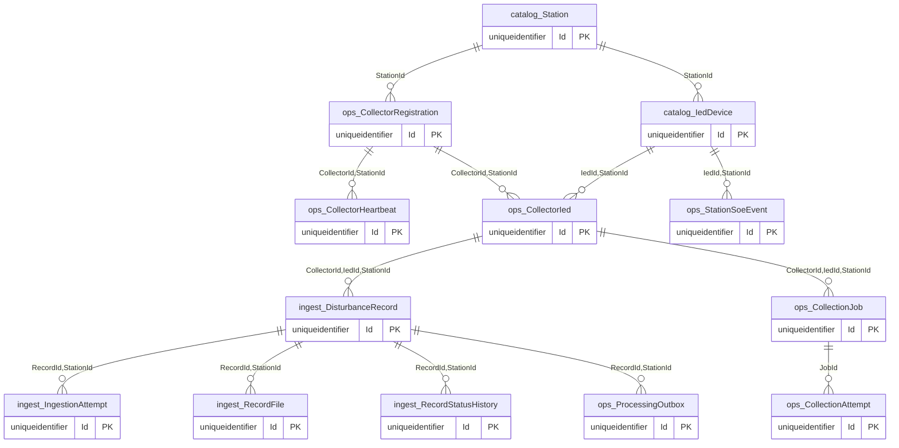
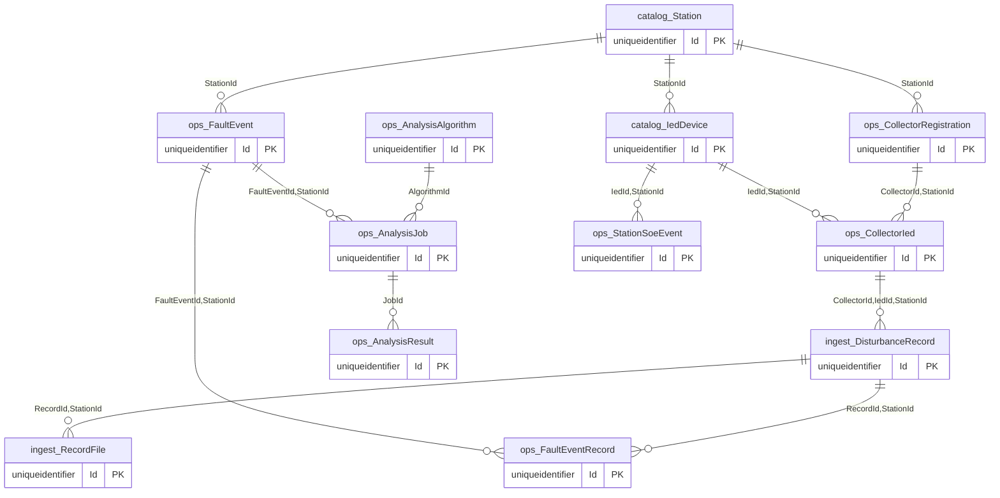

# Deployed overall and domain ERDs

2026-11-08 · Development/Lab only. Source a0a6096dbf2c192cc2c674175c17137f59a17e47; baseline PR5 9cd35889ddbbcc8d88e831419284877f4add5c6a. Official checkout tmp/FDC_FRS-phase2-delivery; original root source unchanged.
Target: local lpc:. / FDC_Center_Lab, SQL2022 16.0.1210.3, MachineName XOTH-ETC-2. Old FdcIam_DevelopmentLab is separate and not migrated/copied. Current user instruction explicitly authorizes new Lab creation/implementation; no owner domain approval inferred.
CURRENT: deployed schema. VERIFIED: only actual checks below. PROPOSED/PENDING: unapproved policies and future workflows. APPROVED: none newly assigned. Reviewer NOT_PROVIDED. No P0-IAM/Lab GO/UAT readiness promotion.
Evidence: Evidence_Index.md and ignored local evidence/. Commands: Database_Deployment_Runbook.md / Database_Test_Plan.md. No password/raw session/private key/DPAPI artifact committed.

Diagrams show CURRENT deployed tables only,not proposed workflows. Edges depict validated present FK references; optional/null participation and composite details are authoritative in relationship matrix/dictionary. Review/approval/retention/algorithm extensions remain proposed in gap register.

## Overall deployed model

```mermaid
erDiagram
  audit_AuditCheckpoint {
    uniqueidentifier Id PK
  }
  audit_AuditDelivery {
    uniqueidentifier Id PK
  }
  audit_SecurityEvent {
    uniqueidentifier Id PK
  }
  catalog_Bay {
    uniqueidentifier Id PK
  }
  catalog_CommunicationProfile {
    uniqueidentifier Id PK
  }
  catalog_Corporation {
    uniqueidentifier Id PK
  }
  catalog_DeviceFirmware {
    uniqueidentifier Id PK
  }
  catalog_DeviceModel {
    uniqueidentifier Id PK
  }
  catalog_Feeder {
    uniqueidentifier Id PK
  }
  catalog_IedDevice {
    uniqueidentifier Id PK
  }
  catalog_ManagementUnit {
    uniqueidentifier Id PK
  }
  catalog_Manufacturer {
    uniqueidentifier Id PK
  }
  catalog_Scope {
    uniqueidentifier Id PK
  }
  catalog_Station {
    uniqueidentifier Id PK
  }
  catalog_StationProfile {
    uniqueidentifier Id PK
  }
  catalog_StationUnitHistory {
    uniqueidentifier Id PK
  }
  catalog_VoltageLevel {
    uniqueidentifier Id PK
  }
  iam_AdministrativeDelegation {
    uniqueidentifier Id PK
  }
  iam_AuthorityVersion {
    uniqueidentifier Id PK
  }
  iam_Challenge {
    uniqueidentifier Id PK
  }
  iam_GrantFunction {
    uniqueidentifier Id PK
  }
  iam_MfaCredential {
    uniqueidentifier Id PK
  }
  iam_PasswordCredential {
    uniqueidentifier Id PK
  }
  iam_Permission {
    uniqueidentifier Id PK
  }
  iam_PersonReference {
    uniqueidentifier Id PK
  }
  iam_Role {
    uniqueidentifier Id PK
  }
  iam_RoleChangeApproval {
    uniqueidentifier Id PK
  }
  iam_RoleChangeRequest {
    uniqueidentifier Id PK
  }
  iam_RolePermission {
    uniqueidentifier Id PK
  }
  iam_Session {
    uniqueidentifier Id PK
  }
  iam_StationGrant {
    uniqueidentifier Id PK
  }
  iam_User {
    uniqueidentifier Id PK
  }
  iam_UserRole {
    uniqueidentifier Id PK
  }
  ingest_DisturbanceRecord {
    uniqueidentifier Id PK
  }
  ingest_IngestionAttempt {
    uniqueidentifier Id PK
  }
  ingest_RecordFile {
    uniqueidentifier Id PK
  }
  ingest_RecordStatusHistory {
    uniqueidentifier Id PK
  }
  ops_AnalysisAlgorithm {
    uniqueidentifier Id PK
  }
  ops_AnalysisJob {
    uniqueidentifier Id PK
  }
  ops_AnalysisResult {
    uniqueidentifier Id PK
  }
  ops_AuditOutbox {
    uniqueidentifier Id PK
  }
  ops_CollectionAttempt {
    uniqueidentifier Id PK
  }
  ops_CollectionJob {
    uniqueidentifier Id PK
  }
  ops_CollectorHeartbeat {
    uniqueidentifier Id PK
  }
  ops_CollectorIed {
    uniqueidentifier Id PK
  }
  ops_CollectorRegistration {
    uniqueidentifier Id PK
  }
  ops_FaultEvent {
    uniqueidentifier Id PK
  }
  ops_FaultEventRecord {
    uniqueidentifier Id PK
  }
  ops_OperationalEvent {
    uniqueidentifier Id PK
  }
  ops_ProcessingOutbox {
    uniqueidentifier Id PK
  }
  ops_RoleHistory {
    uniqueidentifier Id PK
  }
  ops_SeedInstallation {
    uniqueidentifier Id PK
  }
  ops_StationSoeEvent {
    uniqueidentifier Id PK
  }
  audit_SecurityEvent ||--o{ audit_AuditDelivery : "EventId"
  iam_User ||--o{ audit_SecurityEvent : "ActorUserId"
  catalog_Station ||--o{ catalog_Bay : "StationId"
  catalog_DeviceModel ||--o{ catalog_DeviceFirmware : "DeviceModelId"
  catalog_Manufacturer ||--o{ catalog_DeviceModel : "ManufacturerId"
  catalog_Station ||--o{ catalog_Feeder : "StationId"
  catalog_Bay ||--o{ catalog_IedDevice : "BayId,StationId"
  catalog_CommunicationProfile ||--o{ catalog_IedDevice : "CommunicationProfileId"
  catalog_DeviceFirmware ||--o{ catalog_IedDevice : "FirmwareId,DeviceModelId"
  catalog_DeviceModel ||--o{ catalog_IedDevice : "DeviceModelId"
  catalog_Feeder ||--o{ catalog_IedDevice : "FeederId,StationId"
  catalog_Station ||--o{ catalog_IedDevice : "StationId"
  catalog_Corporation ||--o{ catalog_ManagementUnit : "CorporationId"
  catalog_ManagementUnit ||--o{ catalog_ManagementUnit : "ParentUnitId"
  catalog_Corporation ||--o{ catalog_Scope : "CorporationId"
  catalog_ManagementUnit ||--o{ catalog_Scope : "ManagementUnitId"
  catalog_Station ||--o{ catalog_Scope : "StationId"
  catalog_ManagementUnit ||--o{ catalog_Station : "ManagementUnitId"
  catalog_Station ||--o{ catalog_StationProfile : "StationId"
  catalog_VoltageLevel ||--o{ catalog_StationProfile : "VoltageLevelId"
  catalog_ManagementUnit ||--o{ catalog_StationUnitHistory : "ManagementUnitId"
  catalog_Station ||--o{ catalog_StationUnitHistory : "StationId"
  iam_Permission ||--o{ iam_AdministrativeDelegation : "PermissionId"
  iam_UserRole ||--o{ iam_AdministrativeDelegation : "UserRoleId"
  iam_User ||--o{ iam_Challenge : "UserId"
  iam_Permission ||--o{ iam_GrantFunction : "PermissionId"
  iam_StationGrant ||--o{ iam_GrantFunction : "StationGrantId"
  iam_User ||--o{ iam_MfaCredential : "UserId"
  iam_User ||--o{ iam_PasswordCredential : "UserId"
  iam_User ||--o{ iam_Role : "CreatedBy"
  iam_User ||--o{ iam_Role : "UpdatedBy"
  iam_PersonReference ||--o{ iam_RoleChangeApproval : "ApproverPersonReferenceId"
  iam_RoleChangeRequest ||--o{ iam_RoleChangeApproval : "RequestId,Revision"
  iam_User ||--o{ iam_RoleChangeApproval : "ApproverUserId"
  iam_User ||--o{ iam_RoleChangeApproval : "ApproverUserId,ApproverPersonReferenceId"
  iam_Role ||--o{ iam_RoleChangeRequest : "RoleId"
  iam_User ||--o{ iam_RoleChangeRequest : "RequesterUserId"
  iam_Permission ||--o{ iam_RolePermission : "PermissionId"
  iam_Role ||--o{ iam_RolePermission : "RoleId"
  iam_User ||--o{ iam_Session : "UserId"
  catalog_Scope ||--o{ iam_StationGrant : "ScopeId"
  iam_UserRole ||--o{ iam_StationGrant : "UserRoleId"
  iam_PersonReference ||--o{ iam_User : "PersonReferenceId"
  iam_Role ||--o{ iam_UserRole : "RoleId"
  iam_User ||--o{ iam_UserRole : "UserId"
  ops_CollectorIed ||--o{ ingest_DisturbanceRecord : "CollectorId,IedId,StationId"
  ingest_DisturbanceRecord ||--o{ ingest_IngestionAttempt : "RecordId,StationId"
  ingest_DisturbanceRecord ||--o{ ingest_RecordFile : "RecordId,StationId"
  ingest_DisturbanceRecord ||--o{ ingest_RecordStatusHistory : "RecordId,StationId"
  ops_AnalysisAlgorithm ||--o{ ops_AnalysisJob : "AlgorithmId"
  ops_FaultEvent ||--o{ ops_AnalysisJob : "FaultEventId,StationId"
  ops_AnalysisJob ||--o{ ops_AnalysisResult : "JobId"
  audit_SecurityEvent ||--o{ ops_AuditOutbox : "EventId"
  ops_CollectionJob ||--o{ ops_CollectionAttempt : "JobId"
  ops_CollectorIed ||--o{ ops_CollectionJob : "CollectorId,IedId,StationId"
  ops_CollectorRegistration ||--o{ ops_CollectorHeartbeat : "CollectorId,StationId"
  ops_CollectorRegistration ||--o{ ops_CollectorIed : "CollectorId,StationId"
  catalog_IedDevice ||--o{ ops_CollectorIed : "IedId,StationId"
  catalog_Station ||--o{ ops_CollectorRegistration : "StationId"
  catalog_Station ||--o{ ops_FaultEvent : "StationId"
  ingest_DisturbanceRecord ||--o{ ops_FaultEventRecord : "RecordId,StationId"
  ops_FaultEvent ||--o{ ops_FaultEventRecord : "FaultEventId,StationId"
  ops_CollectorRegistration ||--o{ ops_OperationalEvent : "CollectorId,StationId"
  catalog_Station ||--o{ ops_OperationalEvent : "StationId"
  ingest_DisturbanceRecord ||--o{ ops_ProcessingOutbox : "RecordId,StationId"
  iam_RoleChangeRequest ||--o{ ops_RoleHistory : "RequestId,Revision"
  iam_Role ||--o{ ops_RoleHistory : "RoleId"
  catalog_IedDevice ||--o{ ops_StationSoeEvent : "IedId,StationId"
```

## IAM/RBAC

```mermaid
erDiagram
  audit_SecurityEvent {
    uniqueidentifier Id PK
  }
  catalog_Corporation {
    uniqueidentifier Id PK
  }
  catalog_ManagementUnit {
    uniqueidentifier Id PK
  }
  catalog_Scope {
    uniqueidentifier Id PK
  }
  catalog_Station {
    uniqueidentifier Id PK
  }
  iam_AdministrativeDelegation {
    uniqueidentifier Id PK
  }
  iam_AuthorityVersion {
    uniqueidentifier Id PK
  }
  iam_Challenge {
    uniqueidentifier Id PK
  }
  iam_GrantFunction {
    uniqueidentifier Id PK
  }
  iam_MfaCredential {
    uniqueidentifier Id PK
  }
  iam_PasswordCredential {
    uniqueidentifier Id PK
  }
  iam_Permission {
    uniqueidentifier Id PK
  }
  iam_PersonReference {
    uniqueidentifier Id PK
  }
  iam_Role {
    uniqueidentifier Id PK
  }
  iam_RoleChangeApproval {
    uniqueidentifier Id PK
  }
  iam_RoleChangeRequest {
    uniqueidentifier Id PK
  }
  iam_RolePermission {
    uniqueidentifier Id PK
  }
  iam_Session {
    uniqueidentifier Id PK
  }
  iam_StationGrant {
    uniqueidentifier Id PK
  }
  iam_User {
    uniqueidentifier Id PK
  }
  iam_UserRole {
    uniqueidentifier Id PK
  }
  ops_AuditOutbox {
    uniqueidentifier Id PK
  }
  ops_RoleHistory {
    uniqueidentifier Id PK
  }
  ops_SeedInstallation {
    uniqueidentifier Id PK
  }
  iam_User ||--o{ audit_SecurityEvent : "ActorUserId"
  catalog_Corporation ||--o{ catalog_ManagementUnit : "CorporationId"
  catalog_ManagementUnit ||--o{ catalog_ManagementUnit : "ParentUnitId"
  catalog_Corporation ||--o{ catalog_Scope : "CorporationId"
  catalog_ManagementUnit ||--o{ catalog_Scope : "ManagementUnitId"
  catalog_Station ||--o{ catalog_Scope : "StationId"
  catalog_ManagementUnit ||--o{ catalog_Station : "ManagementUnitId"
  iam_Permission ||--o{ iam_AdministrativeDelegation : "PermissionId"
  iam_UserRole ||--o{ iam_AdministrativeDelegation : "UserRoleId"
  iam_User ||--o{ iam_Challenge : "UserId"
  iam_Permission ||--o{ iam_GrantFunction : "PermissionId"
  iam_StationGrant ||--o{ iam_GrantFunction : "StationGrantId"
  iam_User ||--o{ iam_MfaCredential : "UserId"
  iam_User ||--o{ iam_PasswordCredential : "UserId"
  iam_User ||--o{ iam_Role : "CreatedBy"
  iam_User ||--o{ iam_Role : "UpdatedBy"
  iam_PersonReference ||--o{ iam_RoleChangeApproval : "ApproverPersonReferenceId"
  iam_RoleChangeRequest ||--o{ iam_RoleChangeApproval : "RequestId,Revision"
  iam_User ||--o{ iam_RoleChangeApproval : "ApproverUserId"
  iam_User ||--o{ iam_RoleChangeApproval : "ApproverUserId,ApproverPersonReferenceId"
  iam_Role ||--o{ iam_RoleChangeRequest : "RoleId"
  iam_User ||--o{ iam_RoleChangeRequest : "RequesterUserId"
  iam_Permission ||--o{ iam_RolePermission : "PermissionId"
  iam_Role ||--o{ iam_RolePermission : "RoleId"
  iam_User ||--o{ iam_Session : "UserId"
  catalog_Scope ||--o{ iam_StationGrant : "ScopeId"
  iam_UserRole ||--o{ iam_StationGrant : "UserRoleId"
  iam_PersonReference ||--o{ iam_User : "PersonReferenceId"
  iam_Role ||--o{ iam_UserRole : "RoleId"
  iam_User ||--o{ iam_UserRole : "UserId"
  audit_SecurityEvent ||--o{ ops_AuditOutbox : "EventId"
  iam_RoleChangeRequest ||--o{ ops_RoleHistory : "RequestId,Revision"
  iam_Role ||--o{ ops_RoleHistory : "RoleId"
```

## Collector and ingestion

## Fault analysis and SOE

## Limits / next action

D01–D10 applicable policy choices remain PENDING. Complete approved Human/Machine routing/PKI, D04 scope providers, D09 all-writer control, D10 archive/custody/restore-epoch acceptance and business analysis workflows before activation. No fake analysis or full DR01–DR29 PASS. Independent review required. No Production/IED/SCADA/firewall/Collector change. Code rollback by reviewed feature revert; database rollback follows guarded runbook, never restore stale effective authority.
